# CI/CD Quality Gates

**Project**: AI-Powered Student Study Assistant MLOps  
**Architecture**: FastAPI Backend (Render) + SPA Frontend (Vercel) + MLflow & DVC (DagsHub)  
**CI Orchestrator**: GitHub Actions (`.github/workflows/ci.yml`)

---

## Executive Overview

This document formally establishes the 10 quality gates enforced across the automated CI/CD pipeline, pre-merge reviews, and staging verification. Every gate defines the purpose, specific checks performed, tooling used, quantitative pass/fail acceptance criteria, automation level, and implementation status.

```mermaid
flowchart LR
    G1[Gate 1: Code Quality] --> G2[Gate 2: Unit & Integration Tests]
    G2 --> G3[Gate 3: Data Quality]
    G3 --> G4[Gate 4: Model Quality]
    G4 --> G5[Gate 5: Risk & Reliability]
    G5 --> G6[Gate 6: API Quality]
    G6 --> G7[Gate 7: Frontend Quality]
    G7 --> G8[Gate 8: Security]
    G8 --> G9[Gate 9: Deployment Quality]
    G9 --> G10[Gate 10: Release Approval]
```

---

## Gate 1 – Code Quality

- **Purpose**: Prevent syntax errors, unhandled exceptions, import cycles, formatting drift, and maintain code readability across Python and TypeScript/JavaScript codebases.
- **Checks Performed**:
  - Python style and error linting (`ruff check`).
  - Formatting compliance (`ruff format --check`).
  - Unused imports, unused variables, and undefined names detection.
  - Consistent import ordering and grouping.
- **Tools Used**: `ruff` (configured via `ruff.toml`).
- **Pass Criteria**: Zero errors reported by `ruff check` and `ruff format --check` on target directories (`src/api`, `src/hobby_learning`, `src/common`).
- **Automation**: **Automated** in GitHub Actions (`backend-quality` job).
- **Status**: **Implemented**.

---

## Gate 2 – Unit and Integration Testing

- **Purpose**: Guarantee functional correctness, regression resistance, and ensure modules behave as specified before code is integrated into `main`.
- **Checks Performed**:
  - Full execution of all backend unit and component tests.
  - Data loading, normalization, and validation tests.
  - Model training pipeline execution and prediction tests.
  - Fast API client endpoint tests and schema error handling tests.
  - Frontend test suites when frontend package is present.
- **Tools Used**: `pytest` (`python -m pytest -q`), `npm test`.
- **Pass Criteria**: 100% test pass rate across all test suites (0 failures, 0 errors). Any skipped test must carry an explicit documented skip rationale (`pytest.mark.skip(reason=...)`).
- **Automation**: **Automated** in GitHub Actions (`backend-quality` and `frontend-quality` jobs).
- **Status**: **Implemented**.

---

## Gate 3 – Data Quality

- **Purpose**: Guarantee raw data integrity, schema consistency, chronological ordering, and prevent future information leakage into model features.
- **Checks Performed**:
  - Dataset schema validation: mandatory presence of non-nullable columns (`order_id`, `user_id`, `problem_id`, `correct`, `attempt_count`, `hint_count`).
  - Data type conversions and numeric validation.
  - Absence of duplicate primary event keys (`order_id`).
  - Validation of binary classification target (`correct` $\in \{0, 1\}$).
  - Validation that unlabelled/untagged interactions are isolated and not grouped into shared skills.
  - Causal chronological sorting validation: all training interactions strictly precede test interactions on `order_id`.
  - Feature leakage check: verifying that current row outcome metrics (`correct`, `attempt_count`, `hint_count`, `ms_first_response`) are excluded from feature vectors.
  - DVC tracking validation: ensuring raw data files are tracked by `.dvc` files rather than Git blobs.
- **Tools Used**: `pytest` (`tests/hobby_learning/test_data.py`), DVC (`data/hobby_learning.dvc`).
- **Pass Criteria**: All data validation assertions pass without exceptions. CI tests run on small lightweight fixtures or processed samples without triggering large remote DVC pulls.
- **Automation**: **Automated** in CI tests.
- **Status**: **Implemented**.

---

## Gate 4 – Model Quality

- **Purpose**: Verify that machine learning models provide genuine predictive value over naive heuristics and satisfy minimum statistical performance thresholds.
- **Checks Performed**:
  - Model evaluation on holdout test set with identical chronological split:
    - **Accuracy**: General classification hit rate.
    - **Precision**: False positive control.
    - **Recall**: Detection rate of positive student outcomes.
    - **F1-Score**: Harmonic balance of precision and recall.
    - **ROC-AUC**: Discriminative rank ordering across classification thresholds.
    - **PR-AUC**: Precision-recall trade-off under class imbalance.
  - Evaluation against Majority-Class Baseline:
    - Candidate models must demonstrate statistically significant improvement in ROC-AUC ($\text{ROC-AUC} \ge 0.65$ vs baseline $0.50$).
    - Candidate models must demonstrate positive precision and recall on the minority class ($0$), unlike the naive baseline which predicts 100% class 1.
  - Generation of confusion matrix and detailed per-class classification reports.
- **Tools Used**: `scikit-learn`, `MLflow` (tracked under experiment `hobby_learning`).
- **Pass Criteria**:
  - Baseline: $\text{Accuracy} \ge 0.69$, $\text{Recall} = 1.0$, $\text{ROC-AUC} = 0.50$.
  - Logistic Regression / HistGradientBoosting: $\text{ROC-AUC} > 0.65$, $\text{Accuracy} > 0.70$, $\text{Precision} > 0.71$, $\text{F1} > 0.81$.
  - CI does **not** re-train models from scratch; it evaluates committed models and validates metrics logged to MLflow.
- **Automation**: **Automated** during model training scripts (`train.py`, `train_lr.py`, `train_hgb.py`); verified via artifacts in CI.
- **Status**: **Implemented**.

---

## Gate 5 – Model Risk and Reliability

- **Purpose**: Ensure models are robust, free from data leakage, calibrated, reproducible, and tracked in version-controlled registries.
- **Checks Performed**:
  - Training/inference feature schema consistency (`scikit-learn` Pipeline with `infer_signature`).
  - Preprocessing isolation: verifying scalers and imputers are fitted solely on training splits.
  - Missing value handling resilience: test inputs containing missing skill IDs or empty histories do not crash the pipeline.
  - Probability bounds: predictions satisfy $p \in [0.0, 1.0]$.
  - Traceability: every training run logs Git commit, dataset path, hyperparameters, metrics, and serialized pipeline to MLflow / DagsHub.
- **Tools Used**: `MLflow`, `joblib`, `pytest` (`tests/hobby_learning/test_train*.py`).
- **Pass Criteria**: Pipeline processes arbitrary valid feature vectors without throwing unhandled exceptions; MLflow run ID and Git commit are traceable.
- **Automation**: **Automated** in unit tests and MLflow runs.
- **Status**: **Implemented**.

---

## Gate 6 – API Quality

- **Purpose**: Ensure backend REST endpoints meet service-level agreements, enforce request validation, provide meaningful error envelopes, and handle CORS safely.
- **Checks Performed**:
  - Application startup without errors (`uvicorn src.api.main:app`).
  - Operational health endpoint `/health` returns HTTP 200 with `status: ok` and `request_id`.
  - Operational readiness endpoint `/ready` validates model artifacts and metadata existence.
  - Request schema validation using Pydantic models (returns HTTP 422 for invalid payloads).
  - CORS middleware validation: preflight `OPTIONS` requests return proper `Access-Control-Allow-Origin` based on `ALLOWED_ORIGINS` environment variable.
  - Error isolation: exceptions return standardized JSON error envelopes containing `request_id`.
- **Tools Used**: `FastAPI`, `Starlette`, `Pydantic`, `pytest` (`tests/api/`).
- **Pass Criteria**: All API endpoint tests pass; container smoke tests successfully curl `/health` and `/openapi.json`.
- **Automation**: **Automated** in GitHub Actions (`backend-quality` and `docker-smoke-test` jobs).
- **Status**: **Implemented**.

---

## Gate 7 – Frontend Quality

- **Purpose**: Ensure the single-page application frontend builds cleanly, handles routing without 404s, communicates with the API backend dynamically, and has no hardcoded localhost dependencies.
- **Checks Performed**:
  - Successful production build (`npm run build`).
  - TypeScript compilation and type-checking (`tsc` / `npm run typecheck`).
  - Zero hardcoded production backend URLs in source code (uses `VITE_API_BASE_URL` or `NEXT_PUBLIC_API_BASE_URL`).
  - SPA routing: all client routes fallback cleanly to `index.html` via `vercel.json` rewrites.
  - API communication error boundaries for network and 5xx errors.
- **Tools Used**: Node.js, `npm`, `vercel.json`.
- **Pass Criteria**: Zero build errors, zero type errors, SPA rewrites configured.
- **Automation**: **Automated** in GitHub Actions (`frontend-quality` conditional job).
- **Status**: **Implemented** (configuration and CI job ready).

---

## Gate 8 – Security

- **Purpose**: Prevent credential leaks, unauthorized CORS access, vulnerable dependencies, and insecure default configurations.
- **Checks Performed**:
  - Secret scanning across full Git commit history using Gitleaks.
  - Python dependency vulnerability scanning using `pip-audit`.
  - Node.js dependency vulnerability scanning using `npm audit`.
  - CORS restrictions: wildcards (`*`) disallowed in production; origins strictly governed by `ALLOWED_ORIGINS`.
  - No secret tokens, API keys, or raw passwords in repository code or Docker layers.
- **Tools Used**: `Gitleaks` GitHub Action (`gitleaks/gitleaks-action@v2`), `pip-audit`, `npm audit`.
- **Pass Criteria**: Zero committed secrets detected by Gitleaks; zero unmitigated high/critical CVEs in serving dependencies.
- **Automation**: **Automated** in GitHub Actions (`secret-scan` and `backend-quality` jobs).
- **Status**: **Implemented**.

---

## Gate 9 – Deployment Quality

- **Purpose**: Validate that live deployments on Render (backend) and Vercel (frontend) deploy cleanly, run smoke checks, and can communicate in production.
- **Checks Performed**:
  - Render Web Service build succeeds (`pip install -r requirements-serving.txt`).
  - Render Web Service starts up on `$PORT` and passes health check on `/health`.
  - Vercel static/SPA deployment succeeds and serves `index.html`.
  - Frontend smoke test: frontend dispatches test request to Render backend URL and receives valid JSON response.
  - Environment variables correctly propagated across platforms (`ALLOWED_ORIGINS` on Render, `VITE_API_BASE_URL` on Vercel).
- **Tools Used**: Render Dashboard / Webhook, Vercel Dashboard / Webhook, `curl`.
- **Pass Criteria**: Both services return HTTP 200 on their root/health endpoints; no CORS cross-origin errors in browser console.
- **Automation**: **Automated** via Render and Vercel native GitHub integration upon merging into `main`.
- **Status**: **Implemented** (configuration files `render.yaml` and `vercel.json` committed).

---

## Gate 10 – Release Approval

- **Purpose**: Formal governance gate enforcing that only verified, audited, and tested artifacts are merged into production.
- **Checks Performed**:
  - All GitHub Actions CI status checks pass (`secret-scan`, `backend-quality`, `docker-smoke-test`, `frontend-quality`).
  - At least 1 peer-review code review approval.
  - Release commit tagged with semantic version (`v1.0.0`).
  - Active DVC data pointer and MLflow model run ID verified and documented.
- **Tools Used**: GitHub Branch Protection Rules, GitHub Pull Requests.
- **Pass Criteria**: PR merge button unlocked only when all required CI checks are green and branch protection criteria are satisfied.
- **Automation**: **Semi-Automated** (enforced by GitHub repository rules).
- **Status**: **Implemented** (configured and documented).

---

## Summary Gate Status Table

| Gate | Name | Automated / Manual | Implementation Status | CI Job |
| :---: | :--- | :---: | :---: | :--- |
| **1** | Code Quality | Automated | **Implemented** | `backend-quality` |
| **2** | Unit & Integration Testing | Automated | **Implemented** | `backend-quality` / `frontend-quality` |
| **3** | Data Quality | Automated | **Implemented** | `backend-quality` |
| **4** | Model Quality | Semi-Automated | **Implemented** | Tracked in MLflow / PyTest |
| **5** | Model Risk & Reliability | Automated | **Implemented** | `backend-quality` |
| **6** | API Quality | Automated | **Implemented** | `backend-quality` / `docker-smoke-test` |
| **7** | Frontend Quality | Automated | **Implemented** | `frontend-quality` |
| **8** | Security | Automated | **Implemented** | `secret-scan` / `backend-quality` |
| **9** | Deployment Quality | Automated | **Implemented** | Render & Vercel Native CI/CD |
| **10**| Release Approval | Semi-Automated | **Implemented** | GitHub Branch Protection |

