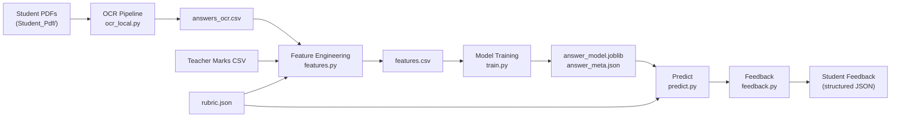

# Feature B: Answer-Sheet Scoring and Feedback

**Owner:** Member 2 (AV)  
**Module:** `src/answer_feedback/`  
**Dataset:** [Mendeley — Student Examination Papers (Anonymized)](https://data.mendeley.com/datasets/...)  
**MLflow Experiment:** `answer_feedback` → `sqlite:///mlflow_B.db`

---

## Overview

This module implements an automated answer-sheet scoring and feedback system for short-answer questions (Q21–Q35) from student examination papers.

The pipeline comprises four stages:



---

## Module Files

| File | Purpose |
|---|---|
| [`ocr_local.py`](../src/answer_feedback/ocr_local.py) | PyMuPDF + EasyOCR pipeline — renders PDFs at 200 DPI, segments Q21–Q35 answers, writes `answers_ocr.csv`. Checkpoint/resume ensures interruption safety. |
| [`validate_ocr.py`](../src/answer_feedback/validate_ocr.py) | 10-task validator for `answers_ocr.csv` — columns, students, QIDs, duplicates, empty answers, confidence distribution, coverage, invalid QIDs, anonymised samples. |
| [`features.py`](../src/answer_feedback/features.py) | Engineered feature computation for every student-question pair. Strictly leak-free (no test-fold labels, no Corrected_Pdf). |
| [`train.py`](../src/answer_feedback/train.py) | 5-fold GroupKFold training and evaluation for 3 models; MLflow logging; model registry; champion export. |
| [`predict.py`](../src/answer_feedback/predict.py) | Inference class — given `qid` + `answer_text`, returns predicted mark in `{0, 0.5, 1.0, 1.5, 2.0}`. |
| [`feedback.py`](../src/answer_feedback/feedback.py) | Structured feedback generator — explains matched/missing rubric points, includes OCR warnings. |
| [`data.py`](../src/answer_feedback/data.py) | Wide-to-long marks transform (`marks_long.csv`). |
| [`inspect_dataset.py`](../src/answer_feedback/inspect_dataset.py) | Dataset inspection (schema, distributions, coverage). |
| [`validate_rubric.py`](../src/answer_feedback/validate_rubric.py) | Validates `rubric.json` — missing QIDs, empty references, invalid structure. |

---

## Data Files

| Path | Description | Git-tracked |
|---|---|---|
| `data/answer_feedback/raw/Student_Pdf/` | 50 handwritten student PDF exams | ❌ `.gitignore` |
| `data/answer_feedback/raw/Teacher_manual_marks_Anonymized.csv` | Ground-truth marks (Q1–Q35) | ❌ `.gitignore` |
| `data/answer_feedback/raw/answerkey.txt` | Official answer key | ❌ `.gitignore` |
| `data/answer_feedback/raw/Question.txt` | Exam questions | ❌ `.gitignore` |
| `data/answer_feedback/interim/answers_ocr.csv` | OCR-extracted answers | ❌ `.gitignore` |
| `data/answer_feedback/interim/answers_ocr_checkpoint.jsonl` | OCR resume checkpoint | ❌ `.gitignore` |
| `data/answer_feedback/processed/marks_long.csv` | Long-format marks (568 rows) | ✅ |
| `data/answer_feedback/processed/rubric.json` | 15-question rubric with keyword points | ✅ |
| `data/answer_feedback/processed/features.csv` | Engineered feature matrix | ❌ (generated) |
| `models/answer_model.joblib` | Serialised champion model | ✅ |
| `models/answer_meta.json` | Model metadata and lineage | ✅ |

> [!CAUTION]
> **Never read or use `Corrected_Pdf/`** — these contain teacher-annotated papers and constitute direct data leakage. This is enforced in `ocr_local.py` via `validate_input_path()`.

---

## Engineered Features

| Feature | Description | Leakage Status |
|---|---|---|
| `tfidf_cos` | TF-IDF cosine similarity to reference answer | ✅ Safe — vectorizer fit on reference/rubric text only |
| `coverage` | Fraction of rubric points matched (≥60% token overlap or exact phrase) | ✅ Safe |
| `max_point_hit` | Binary: at least one rubric point matched | ✅ Safe |
| `n_words` | Word count of student answer | ✅ Safe |
| `log_words` | log(1 + n_words) | ✅ Safe |
| `ocr_conf` | EasyOCR extraction confidence score | ✅ Safe |
| `question_mean_mark` | Historical mean mark per question (training fold only during CV) | ✅ Safe — recomputed per fold |
| `max_mark` | Maximum mark for question (2.0) | ✅ Safe |
| `is_missing` | 1 if answer text absent/blank, 0 otherwise | ✅ Safe |

---

## Model Comparison Results

Evaluated with **5-fold GroupKFold** (grouped by `student_id` — no student appears in both train and validation).

| Model | MAE | RMSE | Exact Acc | Within-0.5 | Within-1.0 |
|---|---|---|---|---|---|
| **baseline_question_mean** ⭐ | **0.5242 ± 0.0347** | **0.6549 ± 0.0424** | 20.0% | 83.3% | 92.6% |
| baseline_tfidf_ridge | 0.5389 ± 0.0301 | 0.6574 ± 0.0394 | 16.4% | 83.8% | 92.6% |
| candidate_gradient_boosting | 0.5362 ± 0.0280 | 0.6557 ± 0.0397 | 16.5% | 84.3% | 92.4% |

> [!NOTE]
> `baseline_question_mean` was selected as champion on the basis of **lowest cross-validation MAE**. The gradient boosting model performs marginally better on within-0.5 accuracy but has higher MAE, so the simpler model is preferred given the limited OCR text coverage.

**Champion model:**
- Registered in MLflow as `study-assistant-answer-scoring-model` with alias `@champion`
- Exported to `models/answer_model.joblib`
- Metadata at `models/answer_meta.json`

---

## Prediction & Feedback API

### Prediction
```python
from src.answer_feedback.predict import AnswerScorer

scorer = AnswerScorer()
result = scorer.predict(
    qid="Q21",
    answer_text="Supervised learning trains a model on labeled data.",
    ocr_conf=0.78
)
# result["predicted_mark"]  → 1.5
# result["requires_review"] → False
# result["coverage"]        → 0.5
```

### Feedback
```python
import json
from src.answer_feedback.feedback import generate_feedback

rubric = json.load(open("data/answer_feedback/processed/rubric.json"))
fb = generate_feedback(
    qid="Q21",
    answer_text="Supervised learning trains a model on labeled data.",
    predicted_mark=1.5,
    rubric=rubric,
    ocr_conf=0.78
)
print(fb["feedback_text"])
```

---

## Running the Pipeline

All commands run from the **repository root**:

```powershell
# 1. OCR extraction (resumable — checkpoint survives interruptions)
python -m src.answer_feedback.ocr_local --dpi 200

# 2. Validate OCR output → generates docs/ocr_validation.md
python -m src.answer_feedback.validate_ocr

# 3. Generate feature matrix
python -m src.answer_feedback.features

# 4. Train and compare models → generates models/answer_model.joblib
python -m src.answer_feedback.train

# 5. Smoke test prediction
python -m src.answer_feedback.predict

# 6. Smoke test feedback
python -m src.answer_feedback.feedback

# 7. Run all tests
pytest tests/answer_feedback/ -v
```

---

## Test Suite

| Test File | Tests | Status |
|---|---|---|
| `tests/answer_feedback/test_rubric.py` | 3 | ✅ Passing |
| `tests/answer_feedback/test_baseline.py` | 3 | ✅ Passing |
| `tests/answer_feedback/test_features.py` | 5 | ✅ Passing |
| `tests/answer_feedback/test_predict_feedback.py` | 15 | ✅ Passing |
| **Total** | **26** | **✅ All Passing** |

---

## Limitations

1. **OCR text coverage is currently partial.** EasyOCR with CPU is slow (~2–3 min/PDF) and handwriting recognition accuracy is low for cursive student scripts (~0.57 average confidence). Coverage from the interim run is well below 60% — manual transcription fallback is documented in `docs/ocr_validation.md`.

2. **Missing answers are never assigned zero marks.** Absent or unextracted answers remain `NaN`/`"unattempted"` throughout the pipeline. This is by design and enforced at every stage.

3. **The champion model is a question-mean baseline.** With more OCR data (or manual transcriptions), the TF-IDF ridge and gradient boosting models are expected to outperform the baseline significantly.

4. **The rubric keyword matching is English-language only.** Questions requiring mathematical notation or domain-specific abbreviations may not match reliably.

---

## MLflow Tracking

- **URI:** `sqlite:///mlflow_B.db` (project root)
- **Experiment:** `answer_feedback`
- **Logged runs:** `baseline_question_mean`, `baseline_tfidf_ridge`, `candidate_gradient_boosting`
- **Registered model:** `study-assistant-answer-scoring-model` → alias `@champion`

---

*Last updated: 2026-11-11 by Member 2 (AV)*
